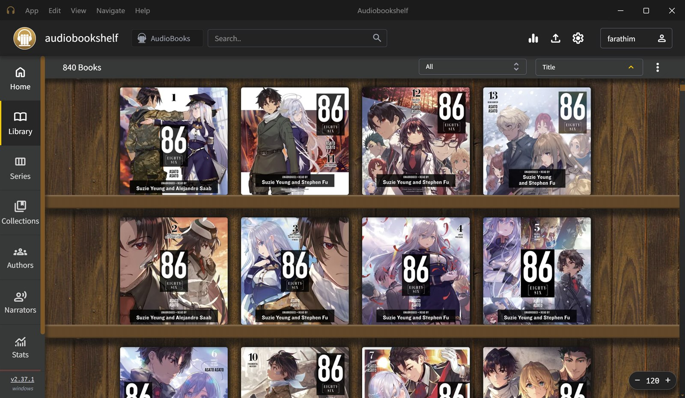
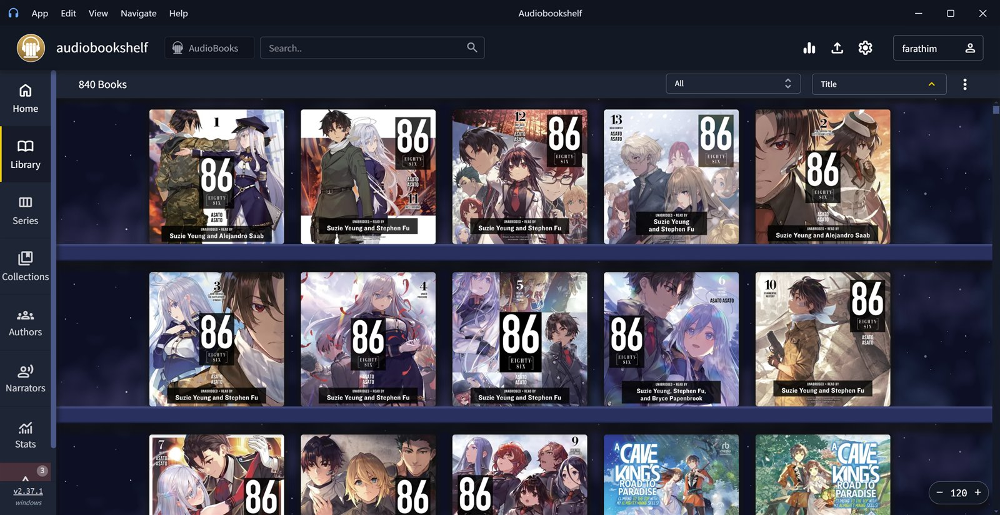
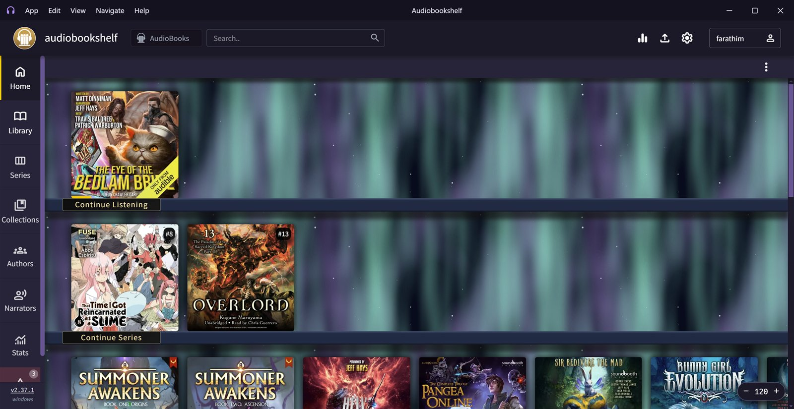
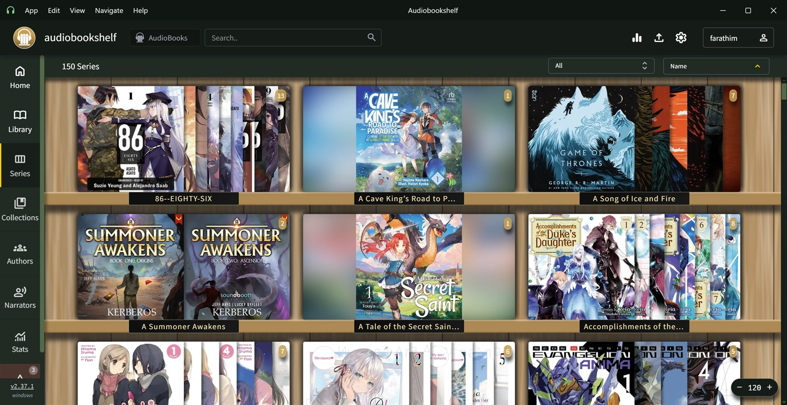
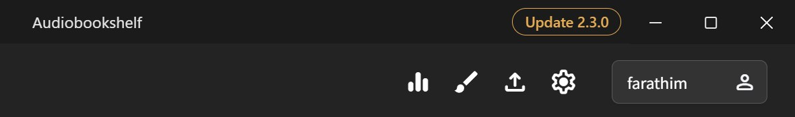
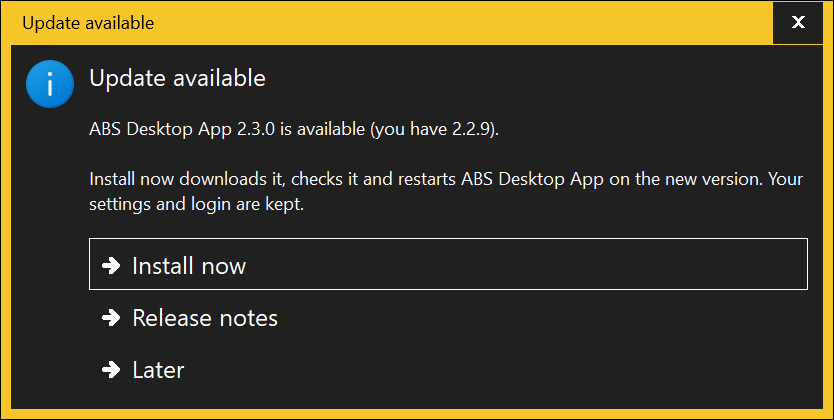

# ABS-DA — ABS Desktop App

An **unofficial Windows desktop app for [Audiobookshelf](https://www.audiobookshelf.org/)**.

It runs your server's **official Audiobookshelf web app** — player, e-book reader and every
admin tool (users, libraries, scanning, metadata editing, uploads, backups, logs, stats…) — in
a proper Windows app, with desktop extras on top: system tray, themes, bookshelf art, saved
login, media keys and more.



> ABS-DA is a community project. It is **not affiliated with or endorsed by** the Audiobookshelf
> project. All the credit for Audiobookshelf itself goes to [advplyr](https://github.com/advplyr)
> and the [Audiobookshelf contributors](https://github.com/advplyr/audiobookshelf).
> Please report ABS-DA problems here, not to the Audiobookshelf issue tracker.

## Download

Get the latest version from the **[Releases](https://github.com/Farathim89/abs-da/releases)** page:

| File | What it is |
|------|------------|
| `ABS-DA-Setup-<version>.exe` | Installer: Start Menu + desktop shortcuts, uninstaller, no admin rights needed |
| `ABS-DA-Portable-<version>.exe` | Single file, no install — settings are kept in an `abs-da-data` folder next to it |
| `ABS-DA-Folder-<version>.zip` | Folder version, no install: unzip it into a folder of its own and run `ABS Desktop App.exe`. Runs fully from that folder (starts faster than the single file, nothing unpacked to Temp); settings in `abs-da-data` next to it |

> **Single file or folder?** The single-file portable unpacks itself into your Temp folder each time
> it starts (that's how a one-file app works; it tidies up old copies by itself). The folder version
> skips that: everything stays in the folder you unzipped it to. Both update with one click.

> **Using the portable?** Give it a folder of its own first, for example `C:\Tools\ABS-DA` or
> `Documents\ABS-DA`, put the `.exe` in it and start it from there. The app keeps its settings and
> login in an `abs-da-data` folder next to the `.exe`, so this keeps everything together and easy
> to move or delete. Avoid running it straight from Downloads or the Desktop, and avoid synced
> (OneDrive/Dropbox) or read-only folders.
>
> **Shortcuts:** use **App → Create Desktop Shortcut**, or pin it to the taskbar. One-click updates
> put the new version in place of the old file, so shortcuts keep working. (The first update renames
> `ABS-DA-Portable-<version>.exe` to plain `ABS-DA-Portable.exe` once, and moves the app's own
> desktop shortcut along; a name you gave the file yourself is kept.)

Windows may show **"Windows protected your PC"** the first time, because the app isn't
code-signed. Click **More info → Run anyway**.

Start it, enter your server address (for example `http://192.168.1.10:13378` or
`https://abs.example.com`) and sign in. Works on your home network and remotely (domain,
dynamic DNS, reverse proxy, VPN).

Requires an Audiobookshelf server (tested with v2.36 and v2.37) and Windows 10 or 11 (64-bit).

## Features

**Everything from the official web app**: audiobooks, podcasts, e-books (EPUB, PDF, CBZ/CBR…),
collections, playlists, series, stats, and — for admin accounts — all the server settings.

**Desktop extras**

- Custom title bar with App · Edit · View · Navigate · Help menus, coloured to match the theme
- Remembers your server, window size and position; the login page shows which server you're on
- **Remember me** on the login page: your login is saved encrypted with Windows (DPAPI) and you're
  signed back in automatically. **App → Forget Saved Login** removes it.
- **Keeps playing in the system tray** when you close the window. Right-click the tray icon for
  what's playing, Play/Pause, skip back/forward, previous/next chapter and a **sleep timer**
- **Start with Windows** (in the tray)
- Keyboard **media keys** and the **Windows media controls** show the book and cover
- **All libraries on one Home page** (library picker → **All libraries**): continue listening, continue
  series, recently added per library (one card per series) and listen again, flat or on bookshelves
- **Offline listening**: a download button next to Play (and **Download series** on series pages) keeps
  books on your PC. The **Offline library** (App → Offline) plays them without the server — chapters,
  speed, sleep timer — and sends your listening back when the server is reachable again. Download queue
  with cancel, optional removal of finished books' offline copies, and the offline library opens by
  itself when the server can't be reached
- **TV mode** (**View → TV mode** or `F10`): a full-screen layout for the couch with a Plex-style side menu, used with an **Xbox or
  PlayStation controller**, a TV remote's arrow keys or the keyboard. Home rows, every library (books,
  series, collections, authors), book pages, search with an on-screen keyboard, and a big **Now
  Playing** screen (chapter and book progress, chapters, ±jump, speed, sleep timer). While a book plays, a dim, moving **screen saver** comes on after 30 s without a press (adjustable). It plays through the web app's own player,
  so progress syncs as usual. **View → TV mode → Start in TV mode** opens it every time the app starts. The
  **⚙ Settings** screen inside TV mode has the app settings for the controller, including locks for the
  chapter and jump buttons against stray presses (also in **View → TV mode**)
- **7 colour themes** (Audiobookshelf, Midnight, OLED Black, Forest, Mocha, Amethyst, **High contrast**) plus *Windows contrast
  colours* — they recolour the whole app, live. Pick them from the **paintbrush** button in the top
  bar (with small previews) or from **View → Theme**. Buttons, switches, pop-up notifications and the
  Stats chart and listening calendar follow the theme too
- **11 mood themes** — Dungeon, Fireside Tavern, Starship, Neon Nights, Deep Sea, Haunted Manor,
  Wizard's Library, Rainy Day, Summer Woods, Autumn Woods, Snowy Night — each with its own scenery, bookshelf, title
  bar, menus, player bar and heading font, a gentle light layer (torches, embers, stars, fog, rain,
  snow…) and optional **mood sounds**: real recordings (crackling fire, rain on glass, cave drips, a starship's hum…),
  all public domain (CC0) from Freesound — see [sounds/CREDITS.txt](sounds/CREDITS.txt) — playing while a book plays or while you browse.
  Animations are light on your PC and pause while you use other windows. Mood themes are an extra:
  tick **Show mood themes** (paintbrush panel, View → Theme or Settings) to see them
- **View → Notifications**: how long pop-up notifications stay (3 s / 5 s / 10 s / until closed),
  where they appear, pause while hovering, theme or original colours
- **Settings, Upload and Account open as an overlay** over the app (close with ✕, Esc or a click outside),
  so the page you're on and what's playing stay put
- **Speaks your language**: menus, tray and dialogs follow the language you use in Audiobookshelf
  (or **View → Language**) — all 33 languages Audiobookshelf has. Fixes welcome: edit `locales/<code>.json`
- **17 bookshelf arts**: woods, stone, materials and scenes (starry night, aurora, ocean), all
  drawn in code
- **Text size** (Small → Largest) in the paintbrush panel or **View → Text size**; `Ctrl` `+`/`-`/`0` and
  Ctrl+mouse wheel work too, and your size is remembered
- Mouse back/forward buttons, `Alt+←` / `Alt+→`, `F5` reload, `F11` fullscreen
- Links to other websites open in your normal browser
- Single sign-on (OpenID: Authentik, Keycloak, Authelia…) — the login provider's page opens
  inside the app and brings you back signed in
- Friendly "can't reach your server" screen, and a check that the address really is Audiobookshelf
- Only one copy runs at a time
- **One-click updates**: when a new version is out, an **Update** button appears in the title bar;
  **Install now** downloads it, checks it against the fingerprint GitHub publishes, installs it and
  restarts — for both the installer and the portable version. Nothing installs without your click
- Troubleshooting: repairs a page that loaded without its styles by itself; **App → Clear Cache and
  Restart…** and **Help → Copy Diagnostics** (for bug reports); the portable tells you if its folder
  isn't writable; **App → Use hardware acceleration** can be turned off if pages draw strangely
- Works with Windows contrast themes without breaking sliders or the e-book reader colours
- Works around Audiobookshelf bug [#4818](https://github.com/advplyr/audiobookshelf/issues/4818)
  (volume slider opening behind the e-book reader)

## Themes and bookshelves

Click the **paintbrush** next to your stats icon for a panel with small previews of every theme and
bookshelf (or use **View → Theme** / **View → Bookshelf**). They change live, no reload.

| Midnight + Starry night | Amethyst + Aurora | Forest + Light oak |
|:---:|:---:|:---:|
|  |  |  |

## One-click updates

When a new version is out, an **Update** button appears in the title bar:



Click it, then **Install now**. ABS-DA downloads the new version, checks it against the
fingerprint GitHub publishes, installs it and restarts, keeping your settings and login.
This works for both the installer and the portable version.



## Privacy

This program will not transfer any information to other networked systems unless specifically
requested by the user or the person installing or operating it. ABS-DA connects to the
Audiobookshelf server you enter, and — to tell you about new versions — asks GitHub for the latest
ABS-DA release (no personal data is sent; turn it off with **App → Check for updates
automatically**). No analytics, no telemetry, no accounts. Settings live in
`%APPDATA%\ABS Desktop App` (or `abs-da-data` next to the portable exe). Your server's own
privacy rules are set by whoever runs it.

## Code signing policy

Release files are built from this repository's source by GitHub Actions
([build workflow](.github/workflows/build.yml)). Releases are not code-signed yet; we're applying
for free code signing from the [SignPath Foundation](https://signpath.org). Once approved:
*Free code signing provided by [SignPath.io](https://about.signpath.io), certificate by
[SignPath Foundation](https://signpath.org).*

Team roles:

- Committers and reviewers: [Farathim89](https://github.com/Farathim89)
- Approvers: [Farathim89](https://github.com/Farathim89)

## Build from source

Needs [Node.js](https://nodejs.org) (LTS).

```bash
npm install
npm start
```

Build the installer and portable exe into `dist\`:

```bash
npm run dist
```

If the build fails with *"Cannot create symbolic link: A required privilege is not held"*,
run `build.cmd` as administrator once (it caches the signing toolkit); after that normal builds work.

### Source files

- `main.js` — window, title bar menus, themes, tray, shortcuts, navigation, settings
- `preload.js` — desktop bridge for the connect screen, Remember me, mouse side buttons
- `server.js` — checks a server address and finds its web app
- `shelf-art.js` — the procedural bookshelf textures (SVG) and their plank colours
- `mood-themes.js` — the mood themes: scenery, light layers, bars and fonts
- `mood-fx.js` — the mood themes' moving light layer, drawn on a canvas over the library
- `ambience.js` — mood sounds: loops the recordings in `sounds/` with a cross-fade (Web Audio, runs in the title bar page)
- `home-page.js` — the All libraries Home page
- `tv-mode.js` — TV mode: the full-screen couch layout, controller and remote input
- `offline.js`, `offline-button.js`, `offline.*` — downloads, the offline library and player, syncing listening back
- `titlebar.*` — the custom title bar (the web app runs in a panel underneath it)
- `connect.*` — the connect / change server / can't-reach screen
- `build/installer.nsh` — removes the Start with Windows entry on uninstall

## Contributing

Bug reports, ideas and pull requests are welcome — [open an issue](https://github.com/Farathim89/abs-da/issues/new/choose)
(or use **Help → Report a Problem** in the app).

## License

ABS-DA is free software: you can redistribute it and/or modify it under the terms of the
**GNU General Public License v3.0 or later** — see [LICENSE](LICENSE). The same licence as
Audiobookshelf itself.

Copyright © 2026 Farathim
